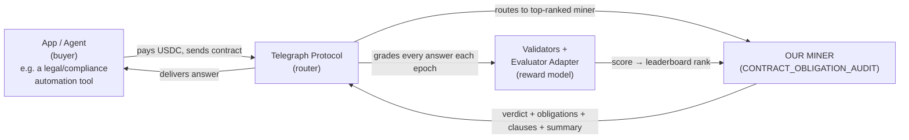
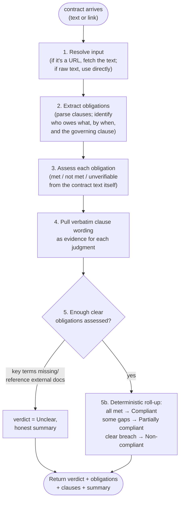
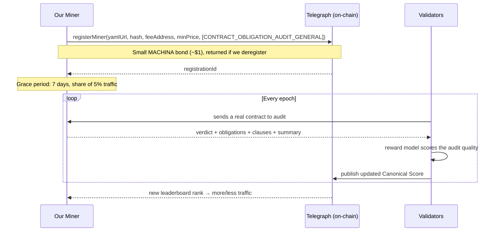

# CONTRACT_OBLIGATION_AUDIT Miner — How It Works (Plain-English Guide)

A service that answers the Telegraph **`CONTRACT_OBLIGATION_AUDIT_GENERAL`** Intent. This is
the **least-crowded Intent of all 136** (only 10 miners), and most of those don't actually
audit contracts.

---

## 1. The one-sentence version

> Someone sends us **a contract** (its text, or a link to it) → we read it, pull out the
> **obligations** (who owes what, by when), judge whether they're being met
> (Compliant / Partially / Non-compliant / Unclear), and cite the exact **clauses**.

---

## 2. Why this is a strong pick

- **Fewest competitors of any Intent: 10 miners** — and ~8 of them are irrelevant data-index
  wrappers (Crossref Funders, Federal Register Docs, USASpending Agencies, Chicago Purchase
  Orders) that just return government datasets and don't audit anything. Only ~2 actually do
  contract auditing (FactWire, ZK Contract).
- **Judgment class** — like our other picks, winning comes from *reasoning quality*, which a
  strong LLM pipeline can deliver.
- **3 commercial missions** want it (real demand).

Trade-off vs TASK_EXECUTION_QUALITY: contracts are longer and messier inputs (needs careful
clause extraction and citation), so it's a bit more work to do well — but the competition is
even thinner.

---

## 3. Where this fits in the bigger picture



Rank #1 → 70% of traffic; #2 → 20%; #3 → 10%. Judgment class = reward model scores the
quality of our verdict, extracted obligations, cited clauses, and summary.

---

## 4. The exact request we receive (real schema, pulled live)

```json
{
  "contract": "...full contract text, or a URL/link to it..."
}
```
One required field: `contract` (string) — the contract text itself, or a link to it.

## 5. The exact response we must send back (real schema)

| Field | Type | Meaning |
|---|---|---|
| `verdict` | enum | One of: `Compliant`, `Partially compliant`, `Non-compliant`, `Unclear` (exact) |
| `obligations` | list | Obligations identified — who owes what, by when |
| `clauses` | list | The exact clause wording cited as evidence |
| `summary` | string | 1–2 sentence summary of the audit |

**Good example:**
```json
{
  "verdict": "Partially compliant",
  "obligations": [
    "Supplier shall deliver all Goods by 2026-03-01 (Clause 4.1)",
    "Buyer shall pay within 30 days of invoice (Clause 6.2)",
    "Supplier shall maintain liability insurance of at least $1M (Clause 9.3)"
  ],
  "clauses": [
    "4.1 The Supplier shall deliver all Goods to the Buyer's premises on or before 1 March 2026.",
    "9.3 The Supplier shall maintain in force comprehensive liability insurance of not less than USD 1,000,000."
  ],
  "summary": "The delivery and payment obligations are clearly defined and appear met, but the contract does not provide evidence that the required $1M liability insurance is in force, leaving one obligation unverified."
}
```

**Honest "Unclear" example:**
```json
{
  "verdict": "Unclear",
  "obligations": ["Reference to 'the attached Schedule A' defining deliverables (Clause 2.1)"],
  "clauses": ["2.1 The Supplier shall provide the services described in Schedule A."],
  "summary": "The contract's core deliverables are defined by reference to Schedule A, which was not supplied, so compliance with the primary obligation cannot be assessed from the text provided."
}
```

---

## 6. What happens inside our service (the pipeline)



**Why cite verbatim clauses (step 4)?** This is a Judgment intent; the reward model rewards
answers that are *grounded in the actual contract text*. Quoting the real clause wording (not
paraphrasing) is the single biggest quality signal and what separates a real audit from a
generic LLM guess. Never fabricate clause text — only quote what's actually in the input.

**Why "Unclear" matters:** contracts often reference external schedules/exhibits not included.
Honestly returning `Unclear` when the text can't support a verdict beats guessing `Compliant`.

---

## 7. How we get paid and ranked



---

## 8. The actual checklist to "win" (be #1 on the evaluator)

1. **Quote real clause text verbatim** — the highest-value quality signal. Never paraphrase or
   fabricate clause wording; only cite what's actually in the contract.
2. **Extract obligations precisely** — who (party), what (duty), by when (deadline), under which
   clause. Specific beats vague.
3. **Keep verdict grounded** — `Compliant` only when the text genuinely supports it; use
   `Unclear` honestly when key terms are missing or reference un-supplied documents.
4. **Handle both inputs** — raw contract text AND a link (fetch and parse the linked text).
5. **Tight, grounded `summary`** — name the decisive obligation(s) and why the verdict follows.
6. **Be fast and reliable** — cache repeat contracts, hard timeouts, never return empty.
7. **Beat the baseline** — most competitors return government dataset rows, not an actual
   audit. A genuine clause-grounded obligation audit clearly outclasses them.

---

## 9. What files this project will have

```
contract-audit-miner/
├── app/
│   ├── main.py            # API endpoint (POST /audit)
│   ├── resolve.py         # raw text vs URL → contract text
│   ├── obligations.py     # extract obligations + governing clauses
│   ├── assess.py          # LLM audit: met / not met / unverifiable per obligation
│   ├── verdict.py         # deterministic roll-up → Compliant/Partially/Non/Unclear
│   └── cite.py            # pull verbatim clause wording (no fabrication)
├── tests/
│   └── test_contracts.py  # sample contracts across all 4 verdicts
├── miner.yaml              # Telegraph miner config (registered on-chain)
├── register.sh              # cast commands to register on Sepolia testnet
└── README.md
```

This matches exactly what the companion Claude Code build prompt will build.
