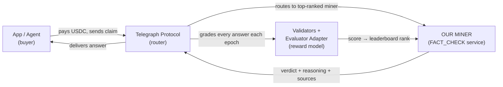
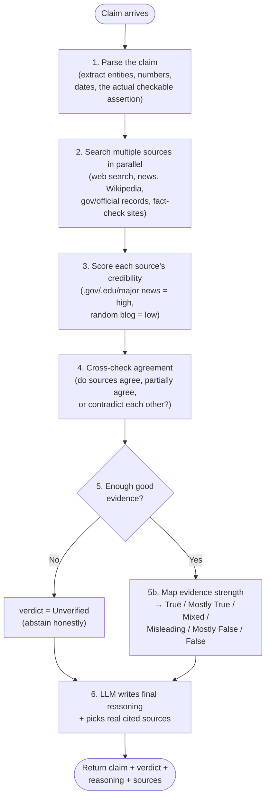
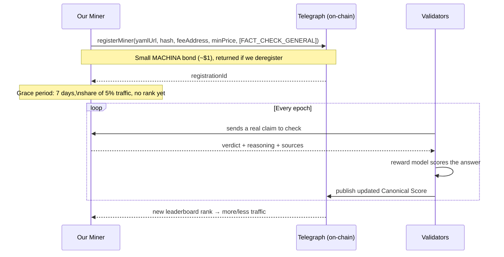

# FACT_CHECK Miner — How It Works (Plain-English Guide)

This explains, in the simplest terms, what we're building: a service that answers the
Telegraph **`FACT_CHECK_GENERAL`** Intent, and tries to rank #1 against the other miners
already serving it.

---

## 1. The one-sentence version

> Someone sends us a claim like *"The Eiffel Tower is taller than the Statue of Liberty"* →
> we research it for real → we send back **True / False / Mixed / Unverified (etc.) + why + sources**.

---

## 2. Where this fits in the bigger picture



- **Apps** are the buyers — they pay to get a claim checked.
- **Telegraph** is the marketplace/router — it picks the best-ranked miner for the Intent.
- **We are the Miner** — we run the actual fact-checking logic behind an API.
- **Validators / Evaluator** grade every answer we give. Because `FACT_CHECK_GENERAL` is a
  **Judgment** intent (no single fixed right answer), a trained reward model reads our
  `reasoning` + `verdict` + `sources` and scores how *good* the answer is — not just
  right/wrong.
- Our **leaderboard rank** decides how much traffic (and money) we get:
  - **#1 ranked miner → 70%** of all requests for this Intent
  - **#2 → 20%**
  - **#3 → 10%**
  - Everyone else → scraps

So "winning" literally means: **be the most accurate, best-evidenced, best-explained fact-checker, consistently.**

---

## 3. The exact request we receive (real schema, pulled live from Telegraph)

```json
{
  "claim": "The Eiffel Tower is taller than the Statue of Liberty."
}
```

That's it — one required field, `claim` (string).

## 4. The exact response we must send back (real schema)

| Field | Type | Meaning |
|---|---|---|
| `claim` | string | The claim we checked (echoed back) |
| `verdict` | enum | One of: `True`, `Mostly True`, `Mixed`, `Misleading`, `Mostly False`, `False`, `Unverified` |
| `reasoning` | string | Why we reached that verdict |
| `sources` | list | URLs/names of the evidence we used |

**Good example:**
```json
{
  "claim": "The Eiffel Tower is taller than the Statue of Liberty.",
  "verdict": "True",
  "reasoning": "The Eiffel Tower stands 330m including antennas (300m to the tip without). The Statue of Liberty, including its pedestal, is 93m tall. Even comparing structure-only heights, the Eiffel Tower is roughly 3x taller. Both figures are corroborated by two independent, authoritative sources.",
  "sources": [
    "https://www.toureiffel.paris/en/the-monument/key-figures",
    "https://www.nps.gov/stli/learn/historyculture/statue-statistics.htm"
  ]
}
```

**Honest "we don't know" example (this matters a lot — see Section 7):**
```json
{
  "claim": "The mayor of this small town secretly sold public land last week.",
  "verdict": "Unverified",
  "reasoning": "No credible news source, government record, or official filing could be found referencing this event within the available evidence window. The claim may be true, false, or fabricated — there isn't enough evidence either way.",
  "sources": []
}
```

---

## 5. What happens inside our service (the pipeline)



**Why abstain instead of guessing (step 5)?** A reward model (the Judgment-class evaluator)
is trained to reward *honest, well-evidenced* answers, not confident wrong ones. Guessing
"True" with no evidence and being wrong scores far worse than correctly saying "Unverified."
This is also what the strongest existing competitor on this Intent (a miner called
"Qarinah ProofPack") already does — it has a formal abstention rule for exactly this reason.

---

## 6. How we get paid and ranked



- Day 0–7: "grace period" — we get a small guaranteed trickle of traffic so we build a track record.
- After day 7: our **Canonical Score** (median of validator scores) sets our rank.
- Rank #1 gets 70% of all traffic for `FACT_CHECK_GENERAL`. That's the prize.
- If we go offline or return empty answers twice in a row, we get **revoked** from routing until the next scoring round — so uptime matters as much as accuracy.

---

## 7. The actual checklist to "win" (be #1 on the evaluator)

1. **Never hallucinate a verdict.** If evidence is thin, say `Unverified`. Confidently wrong answers are the single biggest reward-model penalty.
2. **Always cite real, checkable sources** — real URLs that actually say what we claim they say. Fabricated or irrelevant sources are worse than none.
3. **Use multiple independent sources**, and explicitly say in `reasoning` when they agree or disagree — this is what separates "True" from "Mostly True" from "Mixed."
4. **Keep `reasoning` tight and evidence-driven** — 2–5 sentences that a human fact-checker would actually write, not a wall of text.
5. **Respond fast and reliably** — cache repeat claims, set hard timeouts, never leave a request hanging (that risks a revocation).
6. **Handle every verdict category correctly**, not just True/False — `Misleading` (technically true but deceptive framing) and `Mixed` (partially true) are where most competitors get lazy. Nailing these is a real edge.
7. **Test against the 19+ miners already live on this Intent before launch** (`GET /engine/v1/intents/FACT_CHECK_GENERAL` shows who's competing) — try the same claims against your own service and sanity-check you're at least as good.

---

## 8. What files this project will have

```
fact-check-miner/
├── app/
│   ├── main.py              # API endpoint (POST /fact-check)
│   ├── search.py            # multi-source evidence retrieval
│   ├── credibility.py       # source trust scoring
│   ├── verdict.py           # evidence → verdict mapping + abstention logic
│   └── reasoning.py         # LLM call that writes final reasoning + sources
├── tests/
│   └── test_claims.py       # known true/false/mixed claims, regression suite
├── miner.yaml                # Telegraph miner config (the file that gets registered on-chain)
├── register.sh                # cast commands to register on Sepolia testnet
└── README.md
```

This matches exactly what the Claude Code prompt (separate file/message) will build.
