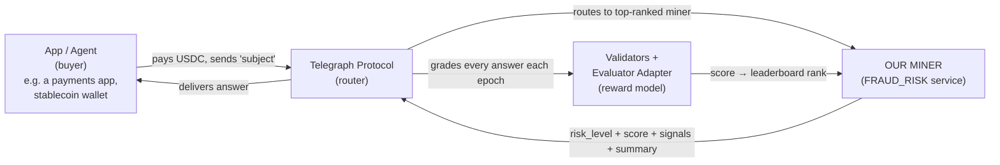
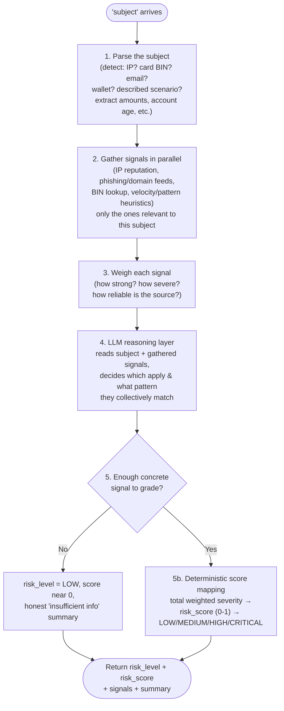
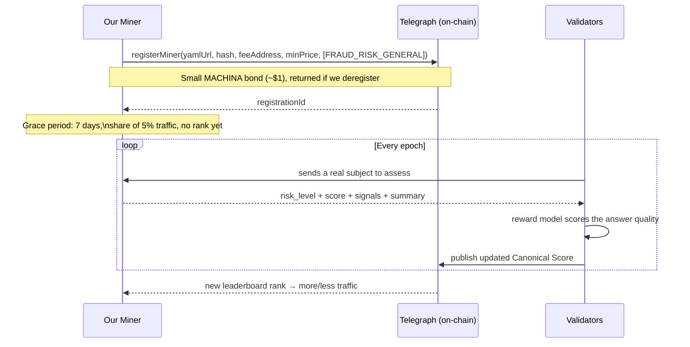

# FRAUD_RISK Miner — How It Works (Plain-English Guide)

This explains, in the simplest terms, what we're building: a service that answers the
Telegraph **`FRAUD_RISK_GENERAL`** Intent, and tries to rank #1 against the other miners
already serving it.

---

## 1. The one-sentence version

> Someone sends us a thing to check — an account, a payment, an IP, an entity, a scenario →
> we send back **how risky it looks for fraud** (LOW/MEDIUM/HIGH/CRITICAL + a 0–1 score),
> plus the **specific red flags** behind that call and a short plain-English summary.

---

## 2. Where this fits in the bigger picture



- **Apps** are the buyers — a payments flow, a stablecoin onboarding check, a consumer
  platform screening a user before letting money move.
- **Telegraph** routes each request to the best-ranked miner for the Intent.
- **We are the Miner** — the actual fraud-scoring logic behind an API.
- **Validators / Evaluator** grade every answer. Because `FRAUD_RISK_GENERAL` is a
  **Judgment** intent, there's no "correct" score to match — the true fraud label only
  appears later, if ever. A reward model judges whether our `risk_level`, `signals`, and
  `summary` are sensible and well-justified.
- Our **leaderboard rank** decides our traffic (and income):
  - **#1 → 70%** of all FRAUD_RISK requests
  - **#2 → 20%**, **#3 → 10%**, rest → scraps.

So "winning" = **be the most sensible, best-justified, multi-signal fraud assessor, consistently.**

---

## 3. THE KEY OPPORTUNITY — the competition here is weak

Pulled live from Telegraph: **15 miners already serve this Intent**, but almost all of them
are thin single-source wrappers:

| Competitor | What it actually does | Weakness |
|---|---|---|
| OpenPhish Fraud Feed | One phishing-domain feed lookup | Single source, no reasoning |
| OTX / IPinfo / IP2Location / IPWho | One IP-reputation lookup each | Single source, no fusion |
| Binlist Payment Fraud | One card-BIN metadata lookup | Single source |
| Skein Listing Verdict | Crypto token-listing risk only | Narrow — not IP/payment/account fraud |
| **RiskWire Fraud Risk** | **LLM reasons over the scenario, returns graded level + explanation** | **The ONE real competitor** |

**Takeaway:** only *one* competitor actually synthesizes signals and reasons. Everyone else
returns one raw lookup. A miner that **combines multiple signals AND reasons about them**
has a genuine shot at #1 — the bar is low.

---

## 4. The exact request we receive (real schema, pulled live from Telegraph)

```json
{
  "subject": "Login from IP 45.133.1.XX on a 2-day-old account attempting a $4,000 transfer to a new payee"
}
```

One required field: `subject` (string) — free text describing the entity, payment, account,
or scenario to assess. It could be an IP, a card BIN, a wallet, an email, or a whole
described scenario.

## 5. The exact response we must send back (real schema)

| Field | Type | Meaning |
|---|---|---|
| `risk_level` | enum | One of: `LOW`, `MEDIUM`, `HIGH`, `CRITICAL` |
| `risk_score` | number | 0 to 1 (0 = safe, 1 = almost certainly fraud), up to 6 decimals |
| `signals` | list | The specific red flags / evidence behind the score |
| `summary` | string | 1–2 sentence plain-English explanation |

**Good example (clear high risk):**
```json
{
  "risk_level": "HIGH",
  "risk_score": 0.84,
  "signals": [
    "Source IP 45.133.1.XX is a known hosting/VPN range flagged for abuse",
    "Account age is 2 days — well below trusted-account threshold",
    "First-ever transfer, high value ($4,000), to a newly-added payee",
    "Transfer amount + new-payee + new-account combination matches account-takeover pattern"
  ],
  "summary": "A high-value first transfer from a brand-new account over a flagged VPN IP to a new payee strongly matches an account-takeover fraud pattern. Recommend step-up verification before allowing the transfer."
}
```

**Honest low-confidence example (don't invent signals — see Section 8):**
```json
{
  "risk_level": "LOW",
  "risk_score": 0.08,
  "signals": ["Insufficient detail in the subject to identify concrete fraud indicators"],
  "summary": "The subject does not contain enough specific information (IP, amount, account history, or identifiers) to detect meaningful fraud signals. Defaulting to low risk with low confidence."
}
```

---

## 6. What happens inside our service (the pipeline)



**Why a deterministic score step (5b) instead of letting the LLM pick the number?**
A reward model rewards *consistent, defensible* assessments. If the same subject gets 0.84
one call and 0.61 the next because the LLM guessed, that's a scoring liability. We let the
LLM decide *which signals apply and how strong*, but turn that into the final number with
fixed, testable logic — so identical inputs give identical scores.

---

## 7. How we get paid and ranked



- Day 0–7: grace period — small guaranteed trickle of traffic to build a track record.
- After day 7: our **Canonical Score** sets our rank; #1 gets 70% of traffic.
- Go offline / return empty answers twice → **revoked** from routing until next scoring round.
  So uptime and never-returning-empty matter as much as quality.

---

## 8. The actual checklist to "win" (be #1 on the evaluator)

1. **Fuse multiple signals** — this is the single biggest edge, because 14 of 15 competitors
   use only one source. Combine at least 2–3 relevant signals per assessment.
2. **Never invent signals.** If the subject is too vague, return `LOW` with an honest
   "insufficient information" summary. Fabricated red flags are the worst reward-model penalty.
3. **Make `signals` concrete and specific** — "IP on a flagged hosting range" beats "IP looks
   risky." Each signal should name the evidence.
4. **Make the `summary` read like a real fraud analyst wrote it** — 1–2 sentences, names the
   decisive signals and the fraud *pattern* they match (account takeover, card testing,
   synthetic identity, phishing, etc.). RiskWire (the one strong competitor) does exactly
   this; match or beat it.
5. **Keep `risk_score` consistent with `risk_level`** — don't return score 0.9 with level LOW.
   Deterministic mapping prevents this.
6. **Detect the subject type and adapt** — an IP, a card BIN, an email, a wallet, and a
   described scenario each need different signal sources. Route accordingly.
7. **Respond fast and reliably** — cache repeat subjects, hard timeouts, never hang. The
   historical target latency for this Intent was < 350ms-class behavior; aim well under 10s
   and never time out (timeouts risk revocation).
8. **Test against the 15 live miners before launch** (`GET /engine/v1/intents/FRAUD_RISK_GENERAL`
   lists them) — run the same subjects through your service and sanity-check you're clearly
   more thorough.

---

## 9. What files this project will have

```
fraud-risk-miner/
├── app/
│   ├── main.py              # API endpoint (POST /fraud-risk)
│   ├── classify.py          # detect subject type (IP / BIN / email / wallet / scenario)
│   ├── signals.py           # multi-source signal gathering (swappable providers)
│   ├── reasoning.py         # LLM layer: which signals apply, what pattern they match
│   ├── score.py             # deterministic severity → risk_score → risk_level mapping
│   └── providers/           # one adapter per signal source (IP rep, phishing, BIN, ...)
├── tests/
│   └── test_subjects.py     # known-risk subjects, every level, abstention cases
├── miner.yaml                # Telegraph miner config (registered on-chain)
├── register.sh                # cast commands to register on Sepolia testnet
└── README.md
```

This matches exactly what the Claude Code build prompt (companion file) will build.
